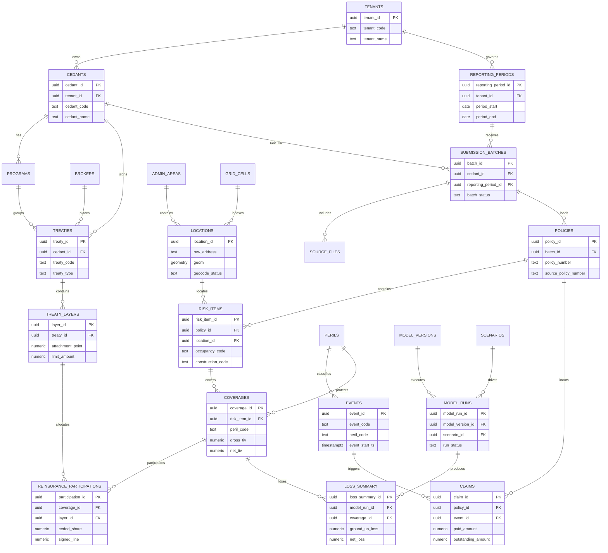

# Nat Cat Platform Database Blueprint

## 1. Design Goal

Nat Cat Platform should not be split into isolated databases by frontend module. The correct design is:

- one shared core risk data platform
- multiple module-specific read models
- one common geospatial and catastrophe modeling backbone

This allows Risk Map, Portfolio Management, Catastrophe Model, and future flood early warning to use the same exposure truth set while serving different workflows.

## 2. Core Principles

1. Shared core data, separate read views
   Risk Map and Portfolio Management must read the same exposure, contract, and location facts.

2. Separate transaction schema and analytics schema
   Operational writes should not be mixed with heavy map aggregation and model output queries.

3. Treat exposure as the core product
   For a reinsurer, the most important shared layer is not a single policy table, but a standardized exposure model.

4. Keep hazard and model results decoupled from source business facts
   Model outputs should be versioned and reproducible.

5. Design for internal and client-facing access from day one
   The same platform must support internal accumulation analysis and cedant-facing reporting with different permissions.

## 3. Recommended Schema Layout

| Schema | Purpose |
| --- | --- |
| `core` | Master data such as tenants, cedants, treaties, perils, reporting periods |
| `ingestion` | File intake, mapping templates, validation issues, ETL audit trail |
| `geo` | Administrative areas, grid cells, geocode cache, spatial reference data |
| `exposure` | Standardized exposure facts: policy, location, risk item, coverage, participation, claims |
| `hazard` | Hazard catalog, event metadata, footprint references, raster/vector layer catalog |
| `model` | Model versioning, scenario definitions, runs, loss outputs |
| `analytics` | Aggregated snapshots, materialized views, API-serving summary tables |

## 4. Module-to-Data Mapping

### Risk Map
- Reads from `exposure.locations`, `exposure.coverages`, `geo.admin_areas`, `hazard.events`, `hazard.layer_catalog`
- Uses area, grid, and peril summaries from `analytics`

### Portfolio Management
- Reads from `core.cedants`, `core.treaties`, `core.treaty_layers`, `exposure.policies`, `exposure.reinsurance_participations`, `exposure.claims`
- Uses contract and accumulation summaries from `analytics`

### Catastrophe Model
- Reads standardized exposure from `exposure`
- Reads event/footprint metadata from `hazard`
- Writes versioned outputs to `model`

### Future Rapid Flood Warning
- Reads live or forecast hazard layers from `hazard`
- Overlays active exposure from `exposure`
- Writes event-specific quick estimates to `model` or `analytics`

## 5. Shared Core Database Answer

Risk Map and Portfolio Management should share the same insurance business core database.

What they should share:

- tenant and cedant master data
- reporting period
- treaty and layer structure
- policy, location, and risk item facts
- exposure values and participation shares
- peril and region dictionaries
- spatial enrichment results

What they should not share directly:

- identical API query models
- identical cache tables
- identical UI-specific summary tables

The rule is: shared facts, separate read models.

## 6. Recommended Entity Model

## 7. Table Responsibilities

### `core`
- `tenants`: supports internal and external data isolation
- `cedants`: direct insurance company master
- `brokers`: optional intermediary master
- `programs`: renewal/program grouping
- `treaties`: treaty header
- `treaty_layers`: attachment, limit, reinstatement, share
- `perils`: canonical peril dictionary
- `reporting_periods`: quarter, half-year, annual, ad hoc cut

### `ingestion`
- `submission_batches`: one cedant submission at one reporting cut
- `source_files`: uploaded file inventory and checksum tracking
- `field_mapping_templates`: source-to-canonical mapping rules
- `validation_issues`: audit trail for bad addresses, missing TIV, invalid peril, and mapping errors

### `geo`
- `admin_areas`: district, TPU, parish, statistical area, future regional hierarchy
- `grid_cells`: model or aggregation grid system
- `geocode_cache`: reusable standardized address lookup store

### `exposure`
- `locations`: one geocoded place with spatial enrichment
- `policies`: source business contract or reported policy header
- `risk_items`: the true exposure grain for map and model usage
- `coverages`: peril-specific insured values and attributes
- `reinsurance_participations`: how risk is allocated to treaty layers
- `claims`: historical loss records for validation and portfolio experience

### `hazard`
- `events`: historical and scenario hazard events
- `layer_catalog`: catalog of raster/vector layers published via GeoServer or file storage
- `footprints`: event-to-layer or event-to-grid references

### `model`
- `model_versions`: versioned model package and assumptions
- `scenarios`: deterministic scenario definition
- `runs`: execution log with audit information
- `loss_summary`: aggregated loss output by run and exposure grain

### `analytics`
- pre-aggregated by area, peril, cedant, treaty, and time slice
- materialized views can be refreshed independently from source tables

## 8. Recommended Grain Decisions

These grain choices are the most important design decisions:

- `submission_batches`: one cedant + one reporting period + one load cycle
- `policies`: one policy header from source data
- `locations`: one unique place after geocoding and standardization
- `risk_items`: one insurable object at one location
- `coverages`: one risk item + one peril or coverage slice
- `reinsurance_participations`: one coverage slice allocated to one treaty layer
- `loss_summary`: one model run + one exposure grain + one loss perspective

## 9. Internal vs Client-Facing Data Access

Use one platform, not separate databases.

Internal users may access:
- cross-cedant accumulation
- model calibration metadata
- internal benchmark layers
- full validation and ingestion audit trail

Client-facing users may access:
- their own cedant submissions
- their own treaty or program scope
- pre-approved analytics and event reports

Enforce this through:
- `tenant_id`
- `cedant_id`
- row-level security or API-layer tenant filtering
- separate service accounts for admin, write, and read-only workloads

## 10. Delivery Advice

Phase 1 should focus on these objects first:

1. `core.cedants`
2. `core.treaties`
3. `core.treaty_layers`
4. `core.reporting_periods`
5. `ingestion.submission_batches`
6. `exposure.locations`
7. `exposure.policies`
8. `exposure.risk_items`
9. `exposure.coverages`
10. `geo.admin_areas`

Once that backbone is live, Risk Map and Portfolio Management can be built on top of the same truth set without diverging.