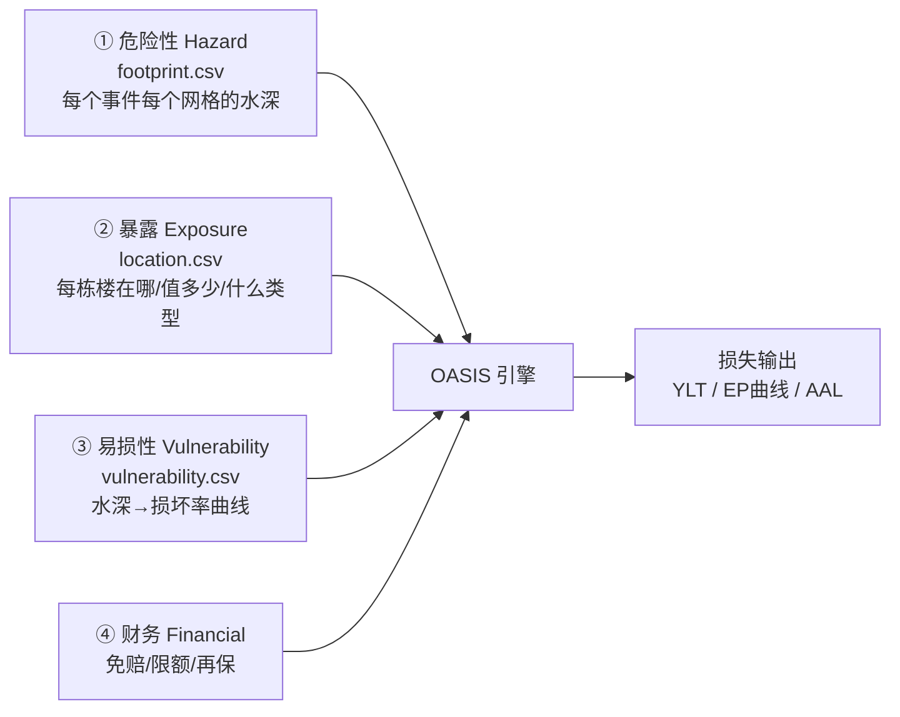
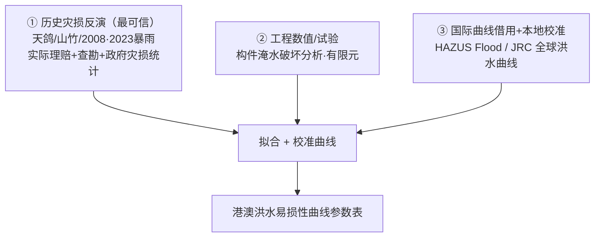
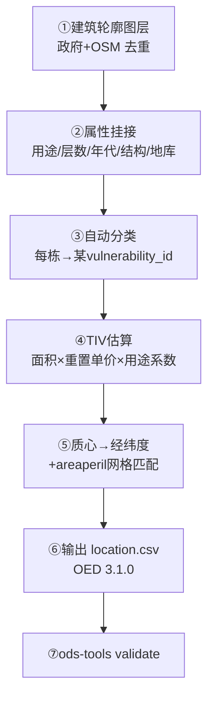

# 港澳台风暨复合洪水巨灾模型
# 高校开发手册：易损性模块 与 暴露模块

> 交付对象：香港 / 澳门 两所合作高校项目组
> 模型框架：OASIS LMF（开放巨灾建模框架）+ OED（Open Exposure Data）暴露标准
> 配套文件：本手册为总纲，细化任务见
> [01-易损性曲线库-任务书](01-易损性曲线库-任务书.md) 与 [02-暴露数据库-建库方案](02-暴露数据库-建库方案.md)
> 版本日期：2026-06

---

## 第一部分 · 总览：你们在整条模型链里做什么

### 1.1 巨灾模型的四大模块

一个 OASIS 巨灾模型由四块拼成，缺一不可：



| 模块 | 谁负责 | 本手册涉及 |
|---|---|---|
| ① 危险性 Hazard | 水文/气象团队（已另行产生事件集） | 否 |
| ② **暴露 Exposure** | **高校 + GIS/政府数据** | ✅ 第三部分 |
| ③ **易损性 Vulnerability** | **高校（工程/水利）** | ✅ 第二部分 |
| ④ 财务 Financial | 精算/核保团队 | 否 |

### 1.2 三个连接键（务必牢记）

四个模块靠三个键拼接，**任何一处对不上，那栋楼损失就是 0**：

| 文件 | 连接键 |
|---|---|
| location.csv（暴露） | `areaperil_id` + `vulnerability_id` |
| footprint.csv（危险性） | `areaperil_id` + `peril_id` |
| vulnerability.csv（易损性） | `vulnerability_id` + `peril_id` |

- **`areaperil_id`** = 空间网格编号 → 暴露的经纬度落到哪个网格，就取那个网格的水深。
- **`vulnerability_id`** = 建筑类别编号 → 暴露的每栋楼挂一个类别，就用那条易损性曲线。
- **`peril_id`** = 灾因（WSS/ORF/OSF）→ 三方必须用同一套单一灾因码。

### 1.3 本模型的灾因约定（已定稿）

| 灾因代码 | 名称 | 强度量纲 | 来源 |
|---|---|---|---|
| **WSS** | 风暴潮淹没 | 淹没水深 (m) | 台风 |
| **ORF** | 河流 / 上游洪水 | 淹没水深 (m) | 台风 + 非台风 |
| **OSF** | 暴雨内涝 / 地表积水 | 淹没水深 (m) | 台风 + 非台风 |

> 说明：本模型聚焦**洪水淹没损失**。台风**强风直接致损（WTC）暂不建模**（港澳钢混高层抗风强、怕淹）。
> 台风暴雨与非台风暴雨**共用同一组 OSF 曲线**，两者区别在事件集层面（event 来源），不在易损性层面。
> ⚠️ `WW1`/`WW2`/`OO1` 是保单打包码，**只出现在暴露的 `LocPerilsCovered`**，绝不进 footprint 或 vulnerability。

---

# 第二部分 · 易损性模块开发指南（高校核心任务）

## 2.1 核心原则：按"类别"建曲线，不逐栋建模

- 你们交付的是 **"建筑类别 → 淹没水深 → 损坏率" 的曲线**，类别总数 **30–80 类**。
- 一条"1980 年前砖混无地库低层住宅"曲线，自动服务全城所有同类楼宇。
- **不要**逐栋编码全城（那是暴露模块的活）。

## 2.2 第一步：用 OED 字段"组合"定义建筑类别

### 2.2.1 为什么不能只用 Occupancy + Construction 两个码

两栋"同样住宅 + 同样钢混"的楼，一栋有地库、首层贴地、1975 建，另一栋无地库、首层抬高 1.5m、2015 建——**水浸损坏率差好几倍**，但这两个码完全一样。决定洪水损坏率的因素**不在这两个码里**。

### 2.2.2 类别 = 一组 OED 字段的组合键（精确字段名，已核实）

每条曲线 `vulnerability_id` 由下列 OED 字段的组合唯一确定：

| OED 字段（精确） | 角色 | 分档示例 |
|---|---|---|
| `OccupancyCode` | 用途 | 1050住宅 / 1100商业 / 1150工业 |
| `ConstructionCode` | 结构 | 5000钢混 / 砖混 / 钢结构 |
| `YearBuilt`（区间） | 年代/防洪设计 | <1980 / 1980–2005 / >2005 |
| `NumberOfStoreys`（区间） | 层数 | 低1–3 / 多4–7 / 高8+ |
| `Basement` + `BasementLevelCount` | **有无地库/层数** | 有/无；0–5 |
| `FirstFloorHeight`（分档） | **首层抬高量** | 0 / 0.3 / 0.6 / 1.0 m |
| `FloodDefenseHeight`（可选分档） | 防洪设施高度 | 有/无 |

> 可选更精细字段：`GroundElevation`/`Datum`/`BaseFloodElevation`（高程，注意 `BaseFloodElevation` 是**水面高程不是水深**）、`FloorsOccupied`、`FoundationType`、`SoftStory`、`ServiceEquipmentProtection`、`FloodDebrisResilience`、`CustomFloodSOP`。

### 2.2.3 港澳本地必须单独成类的建筑（不能用通用类糊弄）

| 香港 | 澳门 |
|---|---|
| 唐楼（旧式无电梯，首层商铺） | 内港老旧低层（最易水浸） |
| 村屋（新界，低层独立） | 新口岸/填海区高层 |
| 填海区高层 | 地库停车场 |
| 劏房密集楼 | 世遗历史建筑（特殊材质） |
| 地铁站 / 地下商场 | 半地下商铺 |

## 2.3 第二步：为每个类别 × 每种灾因建立 depth-damage 曲线

### 2.3.1 每条曲线要给的数据点

对每个 (类别, 灾因 WSS/ORF/OSF)，给一组离散点：

| 字段 | 说明 | 示例 |
|---|---|---|
| 淹没水深 (m) | 自变量，建议非均匀分档 | 0.0, 0.3, 0.5, 1.0, 1.5, 2.0, 3.0, >3.0 |
| 平均损坏率 MDR | 0–1，该水深下的平均损坏比例 | 0.05, 0.15, 0.30 … |
| **损坏率不确定性** | 标准差 或 P10/P50/P90 分位 **必须给** | σ=0.08 |
| 适用 TIV 构成 | Building / Contents / BI 分别给 | 三条子曲线 |

> ⚠️ **为什么必须给不确定性**：OASIS 的易损性不是一条确定曲线，而是**每个水深对应一个损坏率的概率分布**。只给均值，模型无法表达"同样水深、不同楼损坏有高有低"，会低估尾部风险（PML）。

### 2.3.2 曲线长什么样（示意）

```
损坏率
 1.0 |                          ____------ 高易损(老唐楼,有地库)
     |                  ___----/
 0.5 |            __--/        ____------ 低易损(新建抬高首层)
     |challenge_-/      __----/
 0.0 |___---======------------------------→ 淹没水深(m)
     0   0.5   1.0   1.5   2.0   3.0
```

特征：有**进水阈值**（首层抬高/防洪设施决定曲线起点），之后随水深上升，最终趋于饱和。

### 2.3.3 Building / Contents / BI 要分开给

| TIV 类型 | 洪水损坏特点 |
|---|---|
| Building（建筑结构） | 水深较高才显著损坏；钢混结构本体往往可修 |
| Contents（财产） | **低水深即重损**——家具电器泡水即报废，曲线上升最快 |
| BI（营业中断） | 与停业天数挂钩，地库/地铁淹没导致长期停运 |

## 2.4 第三步：数据来源与校准（按可信度排序）



| 来源 | 用途 | 注意 |
|---|---|---|
| **历史灾损反演** | 主要类别的首选 | 需把理赔额反算成损坏率（除以 TIV），剔除非洪水损因 |
| **工程数值/试验** | 数据稀缺类别补充 | 实验室结果需用真实灾损校验 |
| **HAZUS Flood depth-damage** | 美国成熟洪水曲线，作基线 | 必须用港澳本地样本校准，标注"借用+校准" |
| **JRC 全球洪水曲线** | 按大洲/用途的 depth-damage | 同上 |

> **校准义务**：凡借用国际曲线的类别，必须用至少少量港澳本地灾损样本调整，并在交付物里**明确标注来源与校准方法**，不得直接套用。

## 2.5 易损性模块交付物

| 编号 | 交付物 | 内容 |
|---|---|---|
| V-A | 港澳统一建筑分类定义文档 | 30–80 类，每类的 OED 字段组合取值 + 文字定义 + 代表案例 |
| V-B | 港澳洪水易损性曲线参数表 | 每类×每灾因（WSS/ORF/OSF）×每TIV类型：水深点+MDR+不确定性+来源 |
| V-C | 组合键 → `vulnerability_id` 映射表 | 类别与 OED 字段的对照 |

### 2.5.1 曲线参数表交付模板（CSV 列头）

```
vulnerability_id, class_name, peril_id, tiv_type,
  occupancy_code, construction_code, year_band, storey_band, basement, first_floor_height_band,
  depth_m, mean_damage_ratio, damage_ratio_sd, data_source, calibration_note
```

> 本团队再把此表离散化为 OASIS 概率式 `vulnerability.csv`（`vulnerability_id, peril_id, intensity_bin_id, damage_bin_id, probability`）。这一步**由本团队做，非高校**。

---

# 第三部分 · 暴露模块开发指南

> 暴露模块以 GIS + 政府数据**自动挂码**为主，高校参与**属性判定规则、本地建筑知识、TIV 估值方法**的制定与校验。

## 3.1 目标：每栋楼一行 OED 记录

`location.csv` 每栋建筑一行，核心字段：

| 字段 | 含义 | 来源 |
|---|---|---|
| `PortNumber`/`AccNumber`/`LocNumber` | 组合/账户/标的编号 | 系统生成 |
| `CountryCode` | HK / MO | 行政区 |
| `Latitude`/`Longitude` | 经纬度（WGS84） | 楼宇质心 |
| `LocPerilsCovered` | 覆盖灾因 `WSS;ORF;OSF` 或 `OO1;WSS` | 业务设定 |
| `BuildingTIV`/`ContentsTIV`/`BITIV` | 三类价值 | 估值模型 |
| `LocCurrency` | HKD / MOP | 行政区 |
| `OccupancyCode`/`ConstructionCode` | 用途/结构码 | 挂码 |
| `NumberOfStoreys`/`YearBuilt` | 层数/年代 | 建筑数据库 |
| `Basement`/`BasementLevelCount` | 地库 | 建筑数据库 |
| `FirstFloorHeight`/`FloodDefenseHeight` | 首层抬高/防洪 | 实测/估算 |
| `FloorArea`/`FloorAreaUnit` | 建筑面积 | 建筑数据库 |

> ⚠️ 暴露每栋楼挂的 `OccupancyCode`/`ConstructionCode`/…组合，**必须**能在易损性库里找到对应 `vulnerability_id`，否则损失=0。

## 3.2 权威数据源

### 3.2.1 香港
| 数据 | 来源 | 用途 |
|---|---|---|
| 建筑轮廓 / 层数 / 3D 模型 | 地政总署、规划署 | 几何 + 基础属性 |
| 物业估价 / 用途 | 差饷物业估价署 RVD | TIV 基线、用途 |
| 楼宇年代 / 结构 | 屋宇署 BD、楼宇普查 | 年代、结构码 |
| 补充几何 / POI | OpenStreetMap | 缺口填补 |

### 3.2.2 澳门
| 数据 | 来源 | 用途 |
|---|---|---|
| 地籍 / 建筑轮廓 | 地图绘制暨地籍局 DSCC | 几何 |
| 楼宇用途 / 估值 | 财政局物业登记、房屋局 | 用途、TIV |
| 区域统计 | 统计暨普查局 DSEC | 区域校准 |

## 3.3 自动建库管线



### 3.3.1 关键步骤说明

- **③ 自动分类**：用规则/ML 把每栋楼（用途+结构+层数+年代+地库+首层抬高）映射到易损性库的某个 `vulnerability_id`。**高校提供分类判定规则**。
- **④ TIV 估算（无实测价值时）**：
  $$TIV_{building} = \text{建筑面积} \times \text{重置单价}(\text{用途/区位})$$
  Contents、BI 再按用途系数推算。来源：RVD 估价、建筑成本指数。**高校协助校准港澳本地单价。**
- **⑤ areaperil 匹配**：经纬度落到危险性网格，写 `areaperil_id`，确保能和 footprint 对接。

## 3.4 分层精度策略（务实落地）

不可能一步到位逐栋精确，按业务需要分档升级：

| 档位 | 粒度 | 适用 | 工作量 |
|---|---|---|---|
| L1 粗 | 行政区/网格汇总 | 快速全局 PML、监管报送 | 小 |
| L2 中 | 按建筑类别聚合 | 组合分析 | 中 |
| **L3 细** | **逐栋** | 单保单核保、精细 EP | 大 |

> 建议：先 L1/L2 跑通全链路出结果，再对**重点组合/高价值标的**升级到 L3。

## 3.5 暴露模块交付物

| 编号 | 交付物 | 责任方 |
|---|---|---|
| E-A | 全港澳建筑暴露图层（含属性） | GIS 团队 |
| E-B | 属性判定规则集（含本地建筑知识） | **高校** |
| E-C | TIV 估算方法文档（含本地重置单价） | 数据团队 + 高校校准 |
| E-D | `location.csv`（OED 3.1.0） | 数据团队 |
| E-E | 暴露↔易损性 `vulnerability_id` 对齐校验报告 | 数据团队 |

---

# 第四部分 · 质量保证与避坑

## 4.1 跨模块一致性检查（最易出错）

| 检查项 | 后果若不满足 |
|---|---|
| 暴露每栋的 `vulnerability_id` 在易损性库存在 | 该栋损失=0（静默错误，最危险） |
| 暴露经纬度落在 footprint 网格内 | 查不到水深 → 损失=0 |
| 三方 `peril_id` 用同一套单一码（WSS/ORF/OSF） | 灾因匹配失败 |
| 港澳两校用**同一套** OED 字段组合键 | 两地曲线无法合并 |
| 强度量纲统一为淹没水深 (m) | 曲线与 footprint 对不上 |

## 4.2 常见错误清单

1. ❌ 只用 `OccupancyCode`+`ConstructionCode` 分类 → 洪水损坏率分不出来。✅ 必加地库/首层抬高/年代。
2. ❌ 把 `WW1`/`OO1` 等打包码写进 footprint 或 vulnerability → 引擎报错。✅ 仅用于暴露 `LocPerilsCovered`。
3. ❌ 易损性只给均值不给不确定性 → 低估 PML。✅ 必给 σ 或分位数。
4. ❌ 直接套用 HAZUS/JRC 曲线不校准 → 不符港澳实况。✅ 用本地灾损校准并标注。
5. ❌ 把 `BaseFloodElevation`（水面高程）当淹没水深用 → 量纲错误。✅ 淹没水深来自 footprint。
6. ❌ Building/Contents/BI 共用一条曲线 → Contents 低水深重损被漏。✅ 分开建。
7. ❌ 两校各搞一套分类 → 无法合并。✅ 统一组合键。

## 4.3 验收总 Checklist

**易损性模块**
- [ ] 双校同一套 OED 字段组合键，类别 30–80
- [ ] 组合键含洪水关键字段（`FirstFloorHeight`/`Basement`/`YearBuilt`）
- [ ] 港澳特殊建筑（地库/唐楼/村屋/内港老楼/世遗）单独成类
- [ ] 每类×每灾因（WSS/ORF/OSF）×每TIV类型有曲线
- [ ] 每条曲线含均值 + 不确定性
- [ ] 历史灾损（天鸽/山竹/暴雨）用于主要类别校准
- [ ] 借用国际曲线已标注来源与校准方法
- [ ] 提供组合键 → `vulnerability_id` 映射表

**暴露模块**
- [ ] 全港澳建筑轮廓覆盖完整（政府+OSM 去重）
- [ ] 每栋有用途/结构/层数/年代/面积/地库（缺失有默认填补规则并标注）
- [ ] 每栋已挂到某 `vulnerability_id`
- [ ] TIV 估算方法文档化（面积×单价×用途系数）
- [ ] 经纬度 WGS84 且全部落在 footprint 网格内
- [ ] 通过 `ods-tools validate`（OED 3.1.0）
- [ ] 暴露↔易损性 `vulnerability_id` 双向对齐无孤儿

---

# 第五部分 · 交付物总清单与时间建议

| 模块 | 编号 | 交付物 | 责任方 |
|---|---|---|---|
| 易损性 | V-A | 建筑分类定义文档（30–80类） | 双校 |
| 易损性 | V-B | 洪水易损性曲线参数表（含不确定性） | 双校 |
| 易损性 | V-C | 组合键→`vulnerability_id` 映射表 | 双校 |
| 暴露 | E-B | 属性判定规则集 | 双校 |
| 暴露 | E-C | TIV 估算方法（本地单价校准） | 数据团队+双校 |
| 暴露 | E-A/D/E | 暴露图层 / `location.csv` / 对齐报告 | GIS/数据团队 |
| 转换 | — | `vulnerability.csv`（OASIS 概率式） | 本团队 |

> 建议顺序：先定**统一分类组合键**（V-A/V-C）→ 暴露据此挂码（E-B）并行启动 → 易损性曲线建模（V-B）→ 本团队转换为 OASIS 格式 → 用 `ods-tools validate` 与 `oasislmf model run --dry-run` 联调验证。
