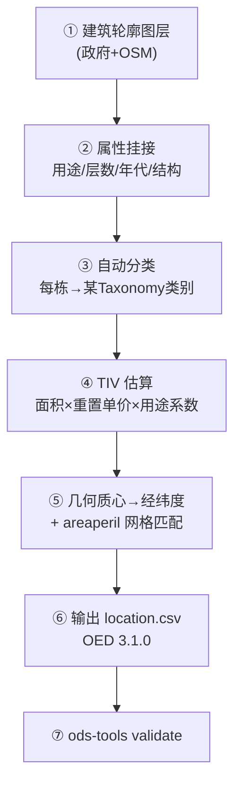

# 港澳台风暨复合洪水巨灾模型 — 暴露数据库（Exposure）建库方案

> 交付对象：GIS / 数据工程团队（非高校）
> 目标：建立全港澳建筑物的 OED 暴露数据库，每栋楼挂上"在哪、值多少、是什么类型"。
> 与易损性的分工：**易损性按"类别"建曲线；暴露按"逐栋"挂属性 + 引用类别**。

---

## 0. 暴露数据库 vs 易损性曲线库（再次厘清）

| | 暴露数据库（本文档） | 易损性曲线库（另一文档） |
|---|---|---|
| 单位 | **每一栋建筑** | 建筑"类别" |
| 数量 | 全港澳几十万～上百万栋 | 30–80 条曲线 |
| 谁做 | **GIS + 政府数据自动挂码** | 高校 |
| 产物 | `location.csv`（OED） | `vulnerability.csv` |
| 每栋的关键动作 | 自动匹配到某一个 Taxonomy 类别 | 不涉及单栋 |

> **绝不可让高校逐栋人工编码全城** —— 用 GIS + 权威数据库自动挂码。

---

## 1. OED location.csv 目标字段（与现有模板对齐）

每栋建筑一行，核心字段：

| 字段 | 含义 | 来源 |
|---|---|---|
| `PortNumber` / `AccNumber` / `LocNumber` | 组合/账户/标的编号 | 系统生成 |
| `CountryCode` | HK / MO | 行政区 |
| `Latitude` / `Longitude` | 经纬度（WGS84） | 楼宇质心 |
| `LocPerilsCovered` | 覆盖灾因，如 `WSS;ORF;OSF` | 业务设定 |
| `BuildingTIV` | 建筑重置价值 | 估值模型 |
| `ContentsTIV` | 财产价值 | 估值模型 |
| `BITIV` | 营业中断价值 | 估值模型 |
| `LocCurrency` | HKD / MOP | 行政区 |
| `OccupancyCode` | 用途码 | 挂码（→Taxonomy） |
| `ConstructionCode` | 结构码 | 挂码（→Taxonomy） |
| `NumberOfStoreys` | 层数 | 建筑数据库 |
| `YearBuilt` | 建成年代 | 建筑数据库 |
| `FloorArea` / `FloorAreaUnit` | 建筑面积 | 建筑数据库 |

> ⚠️ OED ≥ 3.1.0：日期 / 字段名需符合规范，最终用 `ods-tools validate` 校验。

---

## 2. 权威数据源（按行政区）

### 2.1 香港
| 数据 | 来源 | 用途 |
|---|---|---|
| 建筑轮廓 / 层数 / 用途 | 地政总署 Lands Dept、规划署、3D 建筑模型 | 几何 + 基础属性 |
| 物业估价 / 用途分类 | 差饷物业估价署（RVD） | TIV 估算基线、用途 |
| 楼宇年代 / 结构 | 屋宇署 BD、楼宇普查 | 年代、结构码 |
| 补充几何 / POI | OpenStreetMap | 缺口填补 |

### 2.2 澳门
| 数据 | 来源 | 用途 |
|---|---|---|
| 地籍 / 建筑轮廓 | 地图绘制暨地籍局（DSCC） | 几何 |
| 楼宇用途 / 估值 | 财政局物业登记、房屋局 | 用途、TIV |
| 统计 | 统计暨普查局（DSEC） | 区域校准 |

---

## 3. 建库流程（自动化管线）

### 3.1 关键步骤说明
- **③ 自动分类**：用规则/ML 把每栋楼的（用途+结构+层数+年代+有无地库）映射到高校 Taxonomy 的某一类，写入 `OccupancyCode`/`ConstructionCode` 及内部 `vulnerability_id`。
- **④ TIV 估算（无实测价值时）**：
  $$TIV_{building} = \text{建筑面积} \times \text{重置单价}(\text{按用途/区位}) $$
  Contents、BI 再按用途系数推算。来源可用 RVD 估价、建筑成本指数。
- **⑤ areaperil 匹配**：用经纬度落到危险性网格，写 `areaperil_id`，确保能和 footprint 对接。

---

## 4. 分层精度策略（务实）

不可能一步到位逐栋精确。建议三档，按业务需要升级：

| 档位 | 粒度 | 适用 | 工作量 |
|---|---|---|---|
| L1 粗 | 行政区/网格汇总（每格一个聚合标的） | 快速全局 PML、监管报送 | 小 |
| L2 中 | 按建筑类别聚合（每类一代表点/区） | 组合分析 | 中 |
| **L3 细** | **逐栋**（每栋一行） | 单保单核保、精细 EP | 大 |

> 建议：先 L1/L2 跑通全链路出结果，再对**重点组合 / 高价值标的**升级到 L3 逐栋。

---

## 5. 与易损性 / footprint 的接口一致性

- 暴露的 `OccupancyCode`/`ConstructionCode`/`vulnerability_id` **必须**能在易损性库里找到对应曲线（否则该栋损失=0）。
- 暴露的经纬度落点 **必须**在 footprint 网格覆盖范围内（港澳范围），否则查不到危险性。
- 三方主键对齐表：

| 文件 | 连接键 |
|---|---|
| location.csv（暴露） | `areaperil_id` + `vulnerability_id` |
| footprint.csv（危险性） | `areaperil_id` + `peril_id` |
| vulnerability.csv（易损性） | `vulnerability_id` + `peril_id` |

---

## 6. 验收 Checklist

- [ ] 全港澳建筑轮廓覆盖完整（政府+OSM 去重）
- [ ] 每栋有 用途/结构/层数/年代/面积（缺失有默认填补规则并标注）
- [ ] 每栋已自动挂到某 Taxonomy 类别（`OccupancyCode`/`ConstructionCode`/`vulnerability_id`）
- [ ] TIV 估算方法文档化（面积×单价×用途系数）
- [ ] 经纬度 WGS84，且全部落在 footprint 网格内
- [ ] 通过 `ods-tools validate`（OED 3.1.0）
- [ ] 与易损性库的 `vulnerability_id` 双向对齐无孤儿

---

## 7. 交付清单

| 编号 | 交付物 | 责任方 |
|---|---|---|
| A | 全港澳建筑暴露图层（含属性） | GIS 团队 |
| B | TIV 估算方法文档 | 数据团队 |
| C | `location.csv`（OED 3.1.0，逐栋或分层） | 数据团队 |
| D | 暴露↔易损性 主键对齐校验报告 | 数据团队 |
